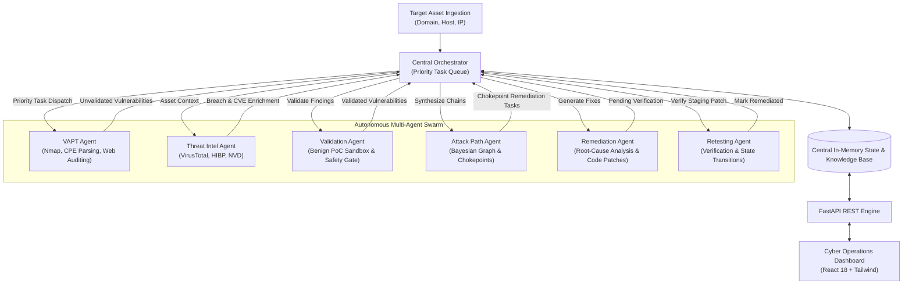

# Autonomous Cyber Defense Platform

[](https://www.python.org/)
[](https://fastapi.tiangolo.com/)
[](https://react.dev/)
[](#multi-agent-system-architecture)

An autonomous, multi-agent AI cyber defense and offensive security orchestration platform. The engine automates the end-to-end vulnerability management lifecycle: from network reconnaissance and static application security testing (SAST), to benign proof-of-concept (PoC) validation, Bayesian attack graph modeling, automated code remediation, and continuous retesting.

---

## Architecture Overview

The platform uses an asynchronous, priority-queue-driven **Central Orchestrator** paired with specialized domain agents communicating via an in-memory thread-safe state store:



---

## Core Agents & Responsibilities

| Agent | Core Functionality |
| :--- | :--- |
| **Orchestrator** | Coordinates the global execution lifecycle, schedules tasks based on integer priority, monitors background agent workers, and prevents task contention. |
| **VAPT Agent** | Conducts network discovery (Nmap), extracts Common Platform Enumerations (CPE) via LLM parsing, executes web vulnerability scanning (SQLi, XSS, CORS, Security Headers), and queries NVD. |
| **Validation Agent** | Crafts deterministic, benign Proof-of-Concepts (PoCs), verifies exploitative signals in an isolated sandbox, enforces safety constraints, and filters out false positives. |
| **Threat Intel Agent** | Correlates discovered assets and hosts with OSINT APIs (VirusTotal v3, HaveIBeenPwned breach feeds, CVE knowledgebase), flagging compromised credentials and known malicious IOCs. |
| **Attack Path Agent** | Models multi-stage exploitation graphs using NetworkX. Computes Bayesian conditional probabilities to identify the most probable paths from Internet-facing assets to internal crown jewels, pinpointing critical chokepoints. |
| **Remediation Agent** | Performs automated root-cause analysis on validated vulnerabilities and synthesizes functional code/config patches across multiple languages (Python, JavaScript, PHP, IaC, Nginx configs). |
| **Retesting Agent** | Automatically verifies remediations against target services, confirming that vulnerabilities are resolved without regressions and updating state from `VALIDATED` to `REMEDIATED`. |

---

## Key Features

- **Model Context Protocol (MCP) Integration**: Features a native stdio MCP server (`tools/vuln_scanner_mcp.py`) supporting:
  - Deep SQL Injection auditing (`scan_sqli` - CWE-89, static/code & signature analysis)
  - Active live SQL Injection detection (`scan_sqli_live` - CWE-89) using **error-based, boolean-blind, and time-based** techniques with strictly non-destructive, read-only payloads — catches blind SQLi that error-only scanners miss
  - Cross-Site Scripting detection (`scan_xss` - CWE-79)
  - Static Application Security Testing (`scan_code_sast` - OWASP Top 10)
  - Live/Simulated web security header and CORS checks (`scan_web_vulnerabilities`)
  - CVE and CVSS intelligence lookups (`query_cve_knowledgebase`)
  - Email & Phishing Threat Detection (`scan_phishing` - Normalized 0-100 Phishing Risk Score & SPF/DMARC validation)
  - Sensitive Directory & File Discovery (`dlr_bruteforce` - Exposed `.env`, `/.git`, `/admin`, `/backup.zip`)
  - API Surface & Authorization Auditing (`api_endpoint_scanner` - OWASP API Top 10, BOLA, Broken Authentication)
  - MITRE ATT&CK Mapping Engine (`mitre_mapper` - Correlates vulnerabilities to Tactics & Technique IDs: T1190, T1566, T1059, T1083, T1210, T1530)
- **Consolidated Attack Corridors & Human-Understandable Flow**:
  - Automatically consolidates redundant same-type attack paths into unified attack corridors.
  - Groups alternative entry vectors (SQL Injection, Directory Exposure, API Broken Auth, Phishing Vector) under a single chokepoint.
  - Generates an intuitive 4-stage visual trajectory (Perimeter Ingress → Secrets Harvesting → Lateral Firewall Bypass → Crown Jewel DB Breach).
  - Provides plain-English executive attack narratives detailing how endpoints lead to the internal crown jewel vault.
- **Strict Safety Gate & Data Sanitization**:
  - Abstract Syntax Tree (AST) validation and command blacklisting before any payload is dispatched.
  - Automatic credential and PII sanitization (redacts JWTs, private keys, passwords, API tokens).
  - Sandboxed execution with strict resource limits and timeouts.
- **Resilient Multi-Model LLM Engine**:
  - Connects to Google Gemini (OpenAI-compatible endpoints), OpenAI, Groq, Ollama, or OpenRouter.
  - Automated fallback cascading across secondary models upon encountering HTTP 429 rate limits or quota exhaustion.
- **Real-Time Visual Operations Dashboard**:
  - Interactive React 18 single-page application (`web/index.html`) with Tailwind CSS and FontAwesome.
  - Real-time scan telemetry, active target submission, categorized vulnerability feeds, interactive attack graphs, and side-by-side patch diffs.

---

## Directory Structure

```text
Autonomous-Cyber-Defense-Platform/
├── .agents/
│   └── mcp_config.json        # MCP server configuration
├── agents/
│   ├── orchestrator.py        # Central priority-queue orchestrator
│   ├── vapt.py                # Reconnaissance & vulnerability discovery
│   ├── validation.py          # Benign PoC generator & safety validation
│   ├── attack_path.py         # NetworkX Bayesian attack graph builder
│   ├── threat_intel.py        # VirusTotal, HIBP, and OSINT connector
│   ├── remediation.py         # AI patch synthesis & root-cause analysis
│   └── retesting.py           # Automated patch verifier
├── api/
│   └── routes.py              # REST API endpoints for scans, targets, reports & stats
├── core/
│   ├── config.py              # Settings loader & environment parser
│   ├── database.py            # Dual-mode asyncpg PostgreSQL / thread-safe in-memory state engine
│   └── models.py              # Pydantic data schemas & state models
├── db/
│   └── schema.sql             # Relational schema for PostgreSQL persistence
├── report/
│   └── report.py              # Executive PDF & structured JSON assessment report generator
├── tests/
│   ├── test_api_endpoints.py  # REST API and scope authorization verification
│   ├── test_attack_path.py    # Bayesian attack path & chokepoint tests
│   ├── test_db_schema.py      # Schema constraints, table definitions & lifecycle tests
│   ├── test_recon_tools.py    # Deterministic reconnaissance tool tests
│   ├── test_retesting.py      # Retest verification & remediation transitions
│   ├── test_safety.py         # AST validator & destructive payload blocking tests
│   └── test_vapt.py           # VAPT discovery & port scanning tests
├── tools/
│   ├── api_connectors.py      # VirusTotal & external API integrations
│   ├── llm.py                 # Resilient multi-provider LLM client
│   ├── recon.py               # Standalone deterministic reconnaissance suite (NVD, HIBP, DNS, etc.)
│   ├── safety.py              # Payload validators, AST checks & data sanitizers
│   ├── sandbox.py             # Isolated execution environment
│   ├── scanners.py            # Reconnaissance wrappers (Nmap, NVD)
│   └── vuln_scanner_mcp.py    # Stdio Model Context Protocol (MCP) server
├── web/
│   └── index.html             # Visual Cyber Operations Dashboard
├── .env.example               # Environment variables template
├── .gitignore                 # Version control exclusions
├── docker-compose.yml         # Containerized stack (PostgreSQL 15 + FastAPI app)
├── Dockerfile                 # Multi-stage production container with nmap & libpq
├── LICENSE                    # MIT License
├── main.py                    # Application entry point (FastAPI server)
└── requirements.txt           # Python dependencies
```

---

## Quickstart Guide

### 1. Prerequisites
- Python 3.10 or higher
- Optional: `nmap` installed on system path for live network port scanning

### 2. Installation

Clone the repository and install the required dependencies:

```bash
git clone git@github.com:rustys-workplace/Autonomous-Cyber-Defense-Platform.git
cd Autonomous-Cyber-Defense-Platform
pip install -r requirements.txt
```

### 3. Environment Configuration

Copy the sample environment file and configure your API credentials:

```bash
cp .env.example .env
```

Edit `.env` with your desired configuration:
```env
# Google Gemini or OpenAI LLM Key
LLM_API_KEY=your_api_key_here
LLM_BASE_URL=https://generativelanguage.googleapis.com/v1beta/openai/
LLM_MODEL=gemini-2.5-flash
LLM_FALLBACK_MODELS=gemini-2.5-flash,gemini-1.5-flash,gemini-2.5-pro,gpt-4o-mini

# External OSINT & Threat Intel (Optional - platform includes simulated fallbacks)
VT_API_KEY=your_virustotal_api_key
HIBP_API_KEY=
NVD_API_KEY=
```

### 4. Running the Platform

#### Option A: Docker Compose (Recommended)
Launch the containerized stack including PostgreSQL 15 and the FastAPI application:
```bash
docker-compose up --build
```

#### Option B: Standalone Python
Start the FastAPI server and background orchestrator locally (defaults to thread-safe in-memory mode if PostgreSQL is not active):
```bash
python main.py
# or
uvicorn main:app --host 0.0.0.0 --port 8000 --reload
```

- **Dashboard UI**: [http://localhost:8000/](http://localhost:8000/) or [http://localhost:8000/dashboard](http://localhost:8000/dashboard)
- **Interactive Swagger Docs**: [http://localhost:8000/docs](http://localhost:8000/docs)
- **ReDoc Documentation**: [http://localhost:8000/redoc](http://localhost:8000/redoc)

### 5. Running the Test Suite
Execute the automated test suite verifying all safety gates, AST validation, Bayesian attack graphs, retest workflows, and reconnaissance tools:
```bash
pytest tests/ -v
```

---

## API Endpoints

| Method | Endpoint | Description |
| :--- | :--- | :--- |
| `POST` | `/api/v1/targets` | Ingest a new target domain/IP and kick off automated discovery |
| `GET` | `/api/v1/assets` | Retrieve all registered target assets and crown jewels |
| `GET` | `/api/v1/targets` | Alias for `/api/v1/assets` |
| `GET` | `/api/v1/vulnerabilities` | List all discovered vulnerabilities and verification statuses |
| `GET` | `/api/v1/attack-paths` | Retrieve computed attack graph paths and chokepoint vulnerabilities |
| `GET` | `/api/v1/remediations/{vuln_id}` | View generated root-cause analysis and code/config patch for a finding |
| `POST` | `/api/v1/retest` | Trigger manual post-fix verification on a patched finding |
| `GET` | `/api/v1/report/json` | Download complete structured security assessment report in JSON format |
| `GET` | `/api/v1/report/pdf` | Download publication-grade executive and technical audit report in PDF format |
| `POST` | `/api/v1/reset` | Clear all session state and database findings to return to standby |
| `GET` | `/api/v1/session` | Get current scan session telemetry and timer state |
| `POST` | `/api/v1/scanners/sast` | On-demand Static Application Security Testing (OWASP Top 10) |
| `POST` | `/api/v1/scanners/web` | On-demand live/simulated web application auditing |
| `POST` | `/api/v1/scanners/sqli` | On-demand active SQL Injection audit (error-based, boolean-blind, time-based) |

---

## Safety & Ethics Disclaimer

> [!IMPORTANT]
> This platform is designed exclusively for authorized penetration testing, defensive vulnerability research, and security engineering assessments. Users are strictly required to obtain explicit, written authorization before running active reconnaissance or validation tests against any target infrastructure. Testing unauthorized targets is strictly prohibited.

---

## License

Distributed under the MIT License. See [LICENSE](LICENSE) for more information.
